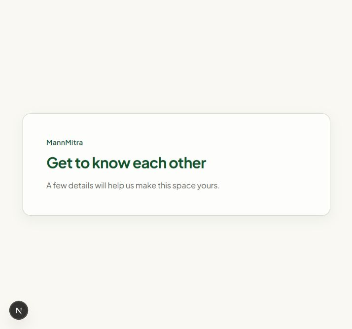

# Step 7: real Google sign-in verification

Date: 2026-10-19 (Asia/Kolkata). Mode: **`google:enabled`**.

The matrix ran through the app's real PKCE browser flow against hosted Supabase project `rgbqzsivegyijacmrfqi`. Google authenticated the approved test inbox `nathankneegrow@gmail.com`; the user entered their password and handled authentication directly. No password was read, logged, written to a file, or saved by the agent. No mocked provider, synthetic Google token, or provider-disabled simulation was used.

## Results

| Order | Case                                                                     | Browser result                                                                         | Hosted evidence                                                                                                                                                   | Result |
| ----- | ------------------------------------------------------------------------ | -------------------------------------------------------------------------------------- | ----------------------------------------------------------------------------------------------------------------------------------------------------------------- | ------ |
| 1     | (c) Existing confirmed password account, then Google with the same email | Exact mandated conflict message; a subsequent `/home` navigation returns to `/signin`. | Prepared user `11167e6f-03fa-4578-afb6-8cd6dfc02de3` retained only its `email` identity; zero active sessions.                                                    | PASS   |
| 2     | Delete the prepared collision fixture through Auth Admin API             | No new Google login was attempted until the fixture was removed.                       | Approved test-address account count became zero.                                                                                                                  | PASS   |
| 3     | (a) First Google sign-in with no existing account                        | `/onboarding` with the onboarding shell.                                               | New user `634b7364-bd97-4a25-aade-1f0aa3c23f88`; confirmed email; only `google` identity; profile provider `google`; display name present; onboarding incomplete. | PASS   |
| 4     | (b) Returning Google account, fresh chooser and OAuth callback           | `/onboarding` again, matching the incomplete onboarding stage.                         | Same user ID and creation time; `last_sign_in_at` advanced from `2026-10-19T16:01:59.848512Z` to `2026-10-19T16:02:54.567719Z`; a fresh session was created.      | PASS   |
| 5     | Remove the temporary Google fixture                                      | Account removed through Auth Admin API.                                                | Zero approved-address test accounts, fixture profiles, and fixture sessions remained.                                                                             | PASS   |

For case (b), the previous app cookie was retained. The test deliberately completed another Google account selection and OAuth exchange; the advanced hosted sign-in timestamp and fresh session prove that this was a new authentication round trip, not merely an already-open onboarding page. It does not claim to be a browser-storage-cleared test. Other stage destinations are covered by the stage-guard tests.

Both cases (a) and (b) reached the localhost callback and the correct app stage. This also verifies the configured localhost callback allowlist in a completed flow rather than relying on authorization-URL reflection.

## Review fix and local verification

Ponytail review found that rejecting a Google collision withheld new cookies but could leave a previous app session cookie in place. The callback now expires existing cookies belonging to this Supabase project, including chunked session and PKCE cookies, while withholding every newly minted session credential. It leaves other project/preference cookies untouched. The contract and generated documentation were updated before implementation. The regression test first failed, then passed, including a server sign-out failure.

The three live identity cases above ran before this cookie-cleanup adjustment; the adjustment does not change identity decisions or successful sign-in. Its prior-cookie failure case is verified by the targeted regression test.

Final required gate: lint, TypeScript, production build, **173 unit/contract tests and 3 production browser checks**. Hosted RLS's separate 58-test result from Wave A remains valid historical evidence; no schema or RLS policy changed in Step 7.

## Source/API correction

The blueprint's proposed Admin unlink method and provider-disabled ID-token simulation were not supported by the installed SDK/current APIs. The implementation uses the [documented session-bound `unlinkIdentity`](https://supabase.com/docs/reference/javascript/auth-unlinkidentity) method, with manual linking enabled and independently probed. [Automatic identity linking](https://supabase.com/docs/guides/auth/auth-identity-linking) occurs inside Supabase before the app callback, so the callback undoes the Google link and rejects the login. No direct SQL edits to Auth identities were used.

The real Google-enabled browser matrix satisfies the intended Gate G4 evidence. Future sessions must rerun it if OAuth/provider behavior or the identity rule changes.

Ponytail review verdict: **Ship** for Step 7. Not checked: Vercel OAuth redirects, a storage-cleared returning-user browser variant, and a real Google identity-unlink outage. Failure branches are covered locally; the other launch gates remain open.
